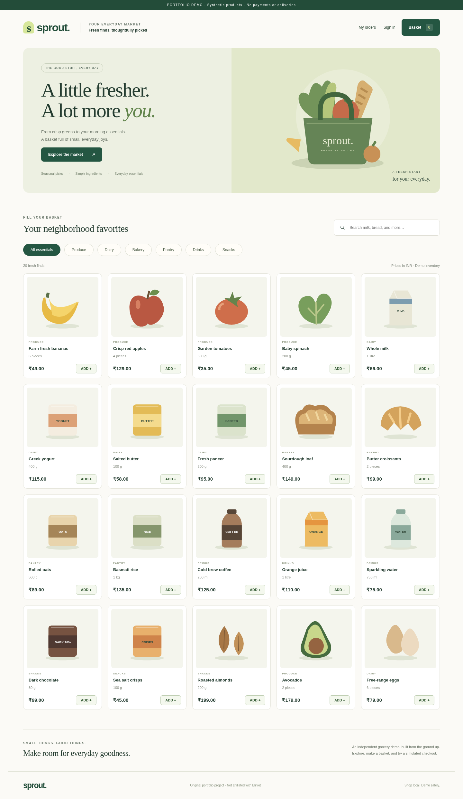

# Sprout Grocery

An original, runnable full-stack grocery portfolio demo for Raj Tiwari. Inspired by the **shopping workflow** of quick-commerce apps, not a copy of Blinkit branding, assets or proprietary code. No affiliation with Blinkit. All catalog entries, inventory, addresses and orders shown in the screenshots are synthetic.



## What works

- Responsive storefront with 20 illustrated products, six categories, search and empty states.
- Guest basket in local storage; authenticated baskets persisted in SQLite and merged on sign-in.
- Registration, password login, logout and expiring server-side sessions.
- Demo checkout with server-authoritative integer-paise prices, atomic stock decrement and idempotent order submission.
- Per-user persisted order history with immutable price/name snapshots.
- Server-protected admin inventory editor and order progression: Demo placed → Demo packed → Demo completed.
- Original local SVG illustrations; no third-party image, font, payment or mapping services.

**This is a local portfolio application, not a real grocery business or production-ready commerce system.** No money is collected. There is no courier dispatch, live tracking or guaranteed delivery time. Use fake emails, demo passwords and invented addresses only.

## Stack

- Frontend: HTML, CSS and browser ES modules (no build step or frontend framework dependency).
- Backend: Python 3.10+, Flask 3.1.2, Werkzeug password hashing.
- Database: SQLite with foreign keys, schema version 1 and transactional orders.
- Tests: pytest, Node's built-in test runner, Chromium via Playwright.
- Locked Python dependencies: `uv.lock`; runtime-only pip alternative: `requirements.txt`.

## Run locally

Install Python 3.10+ and [uv](https://docs.astral.sh/uv/getting-started/installation/).

```bash
uv sync --frozen
uv run python manage.py init-db
uv run python manage.py run
```

Open **http://127.0.0.1:5057**. Initialization creates `instance/sprout.sqlite`, applies the included schema and seeds the catalog if empty. Restarting preserves existing records; it does not reset stock or orders. The development server binds loopback only, with debugging disabled.

Alternative without uv:

```bash
python -m venv .venv
# Linux/macOS:
. .venv/bin/activate
# Windows PowerShell instead:
# .venv\Scripts\Activate.ps1
python -m pip install -r requirements.txt
python manage.py run
```

The same code serves both frontend and API, so there is no separate frontend port, npm install or CORS configuration.

## Try the customer flow

1. Add a couple of products to your basket.
2. Choose **Sign in to checkout**, then **Create an account**.
3. Use an invented email such as `shopper@example.test` and a unique demo password of at least 10 characters.
4. Enter an invented address such as `123 Example Street, Demo City`.
5. Place a **demo** order and open **My orders**. No payment is taken.

## Create your own local admin

There is **no shipped default admin account or password** in the application database. Create one explicitly:

```bash
uv run python manage.py create-admin
```

Enter a local demo email, name and password at the prompts. The password prompt does not echo. Sign in through the same storefront; the **Admin** button appears only for an admin. Direct admin API calls also check the database role; hiding the UI is not the security boundary. Product prices in the admin editor are **paise**, so `5200` means ₹52.00. Order snapshots retain their original prices after inventory edits.

Automated browser tests create an isolated admin **only inside a temporary test database** and discard it at the end. Those example test credentials cannot sign in to a normal fresh installation.

## Configuration

`.env.example` documents supported environment variables; **it is a reference, not automatically loaded**. Set variables through your terminal or hosting environment. Never commit `.env`, database files or real credentials.

```bash
# Optional Linux/macOS example:
export SPROUT_DATABASE=/absolute/path/to/sprout.sqlite
# Only behind a properly configured HTTPS setup:
# export SPROUT_HTTPS=1
uv run python manage.py run --port 5057
```

PowerShell equivalents: `$env:SPROUT_DATABASE='C:\demo\sprout.sqlite'` and `$env:SPROUT_HTTPS='1'`. If HTTPS cookies are enabled on plain HTTP, browsers will not send them. By default the demo accepts `localhost` and `127.0.0.1` hosts only. Do not expose Flask's development server on the internet.

## Tests

```bash
uv sync --frozen --group dev
uv run pytest -q
# Node 20+ (development only):
node --test tests/core.test.mjs
# Actual browser checks, isolated server + temporary database:
uv run playwright install chromium
# Linux may additionally need: uv run playwright install-deps chromium
uv run python scripts/check_browser.py
```

The browser test runner starts and stops its own loopback server, creates fake data, tests end-to-end flows, records screenshots in `docs/screenshots/`, then deletes its temporary database. It does not change your normal app database. See [validation](docs/VALIDATION.md) for actual results and boundaries, and [security](docs/SECURITY.md) for safeguards and remaining work.

## Project map

```text
manage.py                       Local server, initialization, admin CLI
sprout/__init__.py               Flask API, auth, catalog, cart, transactional orders
sprout/schema.sql               Versioned schema and constraints
sprout/static/index.html        Accessible storefront shell
sprout/static/style.css         Responsive original design
sprout/static/app.mjs            Customer and admin UI, API integration
sprout/static/core.mjs           Pure cart/currency helpers
sprout/static/art/*.svg          Original product illustrations
scripts/check_browser.py        Disposable full-stack browser test harness
tests/                          Backend, frontend and browser checks
docs/                           API, security, validation and actual screenshots
```

## Scope and next steps

This implementation covers the promised portfolio shopping/admin flow end-to-end. It deliberately does **not** implement real payments, SMS OTP, email verification/password recovery, saved personal addresses, actual delivery logistics, refunds, taxes, coupons, multi-store catalogs or a native mobile application. No third-party accounts are connected. A commercial launch would need a separate requirements/security/privacy review, HTTPS hosting, robust operational monitoring and audited payment integration.

## Attribution

Prepared for Raj Tiwari with Wabi AI assistance. Implementation, synthetic seed catalog, tests, documentation and original SVG art were AI-assisted. Do not describe it as prior employer/client work or invent usage, revenue, delivery performance or authorship claims. Runtime open-source dependencies retain their respective licenses; no proprietary Blinkit code or assets were used. Project code and original art are MIT licensed.
